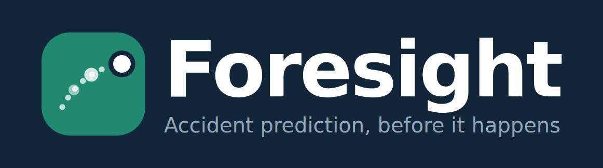

# Foresight — Edge-AI Accident Prediction

**Predict accidents seconds before they happen, on a ~$100 Raspberry Pi + webcam. No video ever leaves the device.**

Foresight watches a room through one camera, turns every frame into a body skeleton, and runs several
prediction engines on it: an AI fall-risk model, danger-zone approach and reach prediction, climbing
detection, and a "motionless person" check. It warns with a soft chime *before* an accident, sounds an
alarm when one is confirmed, logs everything to a dashboard, and alerts guardians on Telegram.

Built for GIBC V2, Track 03 (Open — General Technical Invention). Research prototype, not a certified safety device.

## Why
- Falls are the leading cause of non-fatal injury ER visits for children; drowning is the leading cause of death for ages 1–4 (CDC).
- Falls are the leading cause of construction worker deaths (OSHA "Fatal Four").
- Most systems *detect* accidents after they happen. Foresight tries to *predict* them.

## Features
| Engine | What it does |
|---|---|
| Fall prediction (AI) | TCN model on 1 s of skeleton motion → fall-risk score; smoothed, must stay high 0.5 s → warning chime |
| Fall confirmation | Lying flat or upside down after a fast drop → alarm; standing 10 s → "recovered"; a fall near a hazard is flagged |
| Danger zones | Guardian draws boxes on a camera snapshot (stove, socket, water, stairs, crib, machinery, drop zone...). Distance is judged from where the feet touch the floor |
| Approach prediction | Seconds until a person reaches a zone → warning before arrival |
| Reach prediction | Seconds until a hand touches a hand-hazard (stove, socket) → warning before contact |
| Climbing | Climbing out of a crib, onto furniture / window sills (tip-over and window-fall risk) |
| Motionless person | Lying still, or still in water → alarm (silent drowning, unconsciousness, worker collapse) |
| Home / Worksite modes | Falls are watched for everyone in both. Home zones use strict rules for young children; Worksite zones cover drop zones, machinery, edges and vehicles |
| Camera view | Angled (corner, recommended) or top-down mounting |
| Dashboard | Three pages: **Overview** (live status, live skeleton over the room, today's timeline, latest alerts), **Activity log** (filters, search, Real / False-alarm feedback), **Danger zones** (snapshot, zone drawing, camera mounting) |
| Alerts | Telegram message with a skeleton image (SMS is a drop-in swap for production) |

**Privacy:** frames are processed on the device and discarded. Only skeletons (33 points) and events are sent.
The only camera image that leaves the device is the zone-setup snapshot, taken when the guardian presses the button.

## Architecture
```
Camera → MediaPipe pose (15 fps) → fall model + zone engine + alert logic → sounds (on device)
                                              │ events, live skeleton
                                              ▼
                         server.py (Flask + SQLite) → dashboard.html, Telegram alerts
```

## Results (fall prediction, Oops! test split — clips never used for training or tuning)
- Data: 20,700 Oops! clips → text + skeleton filtering + manual spot-checks → 1,045 fall clips + 641 normal clips
- Model: temporal convolutional network (TCN) on MediaPipe skeletons, 1 s window at 15 fps
- At the calibrated threshold (≤15% of normal validation clips falsely warned):
  warning before impact on **39%** of falls, **≥1 s ahead on 23%**, ≥2 s ahead on 10%; 12% of normal clips falsely warned
- Adding velocity features did not significantly improve results; short lead-up footage in YouTube clips is the main limit
- See `data/oops/results/` for the test report, calibration table and risk curves

## Setup (Ubuntu 24.04 / Raspberry Pi OS, Python 3.11–3.12)
```bash
git clone <this repo> && cd <repo>
python3 -m venv venv && source venv/bin/activate
pip install torch --index-url https://download.pytorch.org/whl/cpu
pip install -r requirements.txt
curl -L -o pose_landmarker.task https://storage.googleapis.com/mediapipe-models/pose_landmarker/pose_landmarker_full/float16/latest/pose_landmarker_full.task
```
The trained model (`data/oops/results/tcn_oops.pt` + `config.json`) is included.

## Run
```bash
python src/server.py                                   # dashboard at http://localhost:8000
python src/live.py --no-display --camera 0             # device (use --camera N for a USB webcam)
python src/live.py --no-display --preview              # + developer view at http://localhost:8001
python src/live.py --video clip.mp4 --save out.avi     # run on a recorded video
TELEGRAM_TOKEN="<bot token>" python src/server.py      # optional Telegram alerts (send your bot a message first)
```
In the dashboard: open **Danger zones**, press **Take snapshot**, draw a box around each hazard (from its top down to the floor in front of it), and choose **Home** or **Worksite** in the sidebar.
Telegram is optional — everything else works without a token.

## Reproducing the training pipeline
`oops_select.py` → `oops_unpack.py` → `oops_extract.py` → `oops_prepare.py` → `oops_normals.py` → `train_oops.py` → `calibrate.py`
(requires downloading the Oops! dataset into `data/oops/`).

## Files
| File | Purpose |
|---|---|
| `src/fallnet.py` | Skeleton preprocessing + TCN model (shared by training and the device) |
| `src/alert.py` | Smoothing, warning / alarm / recovered logic, fall confirmation |
| `src/zones.py` | Zone types, depth-from-floor, approach / reach prediction, climbing, motionless |
| `src/live.py` | Device program |
| `src/server.py`, `src/dashboard.html` | API, SQLite database, dashboard, Telegram alerts |
| `src/snapshot.py` | Upload a camera / video frame for zone drawing |
| `src/video_assets.py` | Exports demo footage (AI-annotated clips, b-roll) from the Oops! clips |
| `docs/` | Logo and screenshots |
| `src/oops_*.py`, `src/train_oops.py`, `src/calibrate.py` | Data pipeline, training, threshold calibration |

## Limitations & future work
- Fall *prediction* is still weak (23% of falls warned ≥1 s ahead); trained mostly on adults in YouTube clips → real, consented child data via the feedback loop
- One person tracked at a time → multi-person tracking
- 2D depth from the floor is approximate; zones must be redrawn if the camera moves → auto-alignment, depth camera
- Distant small hazards (sockets, wiring) → 4K smart cropping, AI-suggested zones (object detection)
- No night vision → infrared camera; can't tell if a stove is hot → thermal sensor
- Falling / tipping objects → "unstable object" zones
- Choking and infant suffocation are out of scope for a skeleton-based system
- Raspberry Pi deployment in progress

## Datasets & credits
- **Oops!** (Epstein, Chen, Vondrick, CVPR 2020) — CC BY-NC-SA 4.0, non-commercial research use
- **UR Fall Detection** (Kwolek & Kepski, 2014) — early prototype
- MediaPipe Pose Landmarker (Google), PyTorch, OpenCV, Flask, scikit-learn, pandas, matplotlib
- Statistics: CDC, CPSC, Safe Kids Worldwide, OSHA

## AI assistance (disclosure)
This project was built with help from **Claude (Anthropic)** as an AI coding assistant. Claude wrote most of the
code (data pipeline, model, alert logic, zones engine, server, dashboard) from the team's design decisions.

What the team did:
- **Problem and direction:** the prediction-not-detection idea, Home/Work modes, the guardian dashboard concept, and
  the questions that shaped the design (judging depth with 2D zone boxes, camera angles, hand-reach hazards, privacy vs. video)
- **Data work:** downloading and organizing the datasets, and the manual spot-checks of kept and rejected clips that
  changed the data-cleanup rules
- **Testing and debugging:** finding that a real ladder fall was logged as "prevented", the missed upside-down landing,
  the ghost skeleton, the stuck alarm, and the snapshot bug, each of which led to a fix
- **Hardware and setup:** the Ubuntu environment, webcam selection and placement, and the Raspberry Pi
- **Experiments:** running every training, calibration and live test, and judging the results

The team can explain how every part of the system works.

## Team
- Mark Joseph V. Nucos
- Jade Cris I. Samuya
- Vyns Samuel T. Hortelano
- Jared Thomas G. Caldo
- Ulysze Antoni P. Reyes
- Andre Lawrence T. Tapusok
